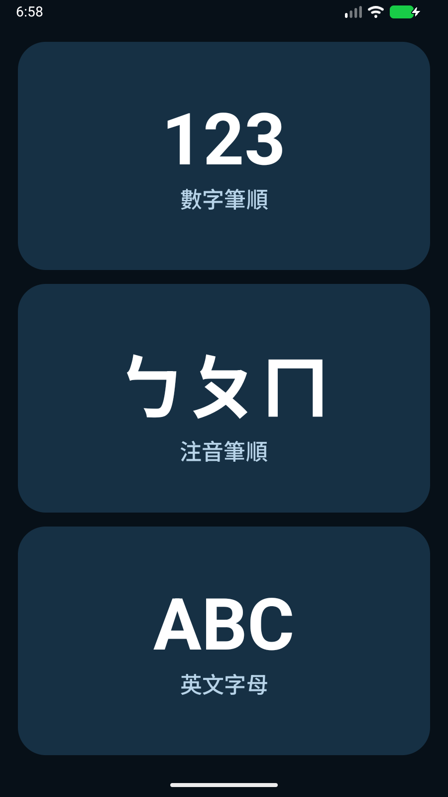
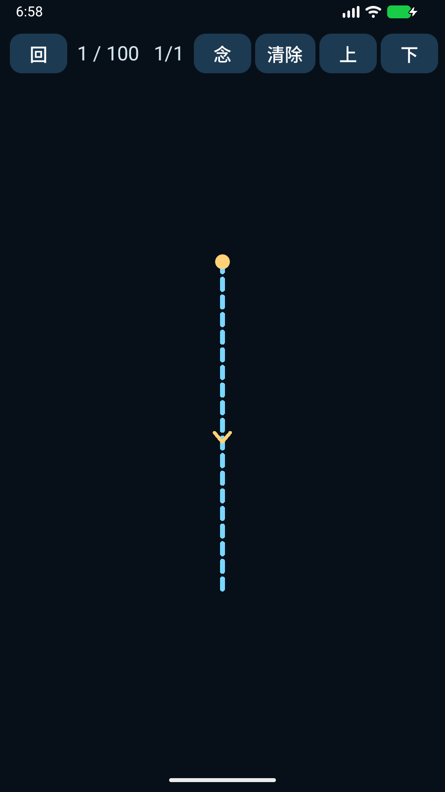
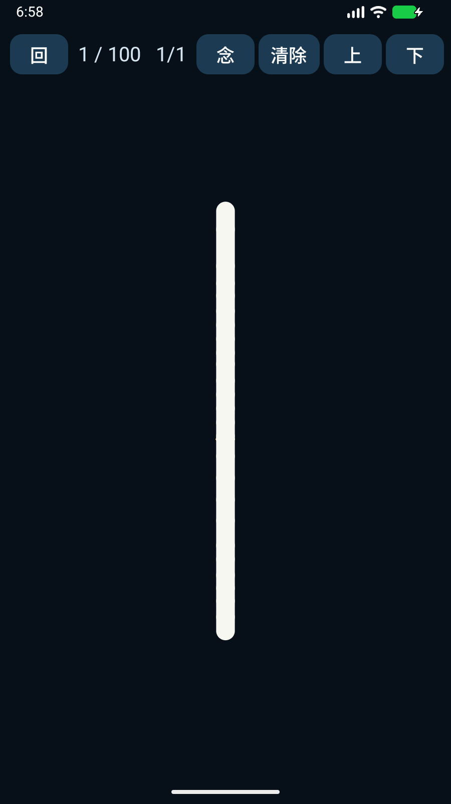
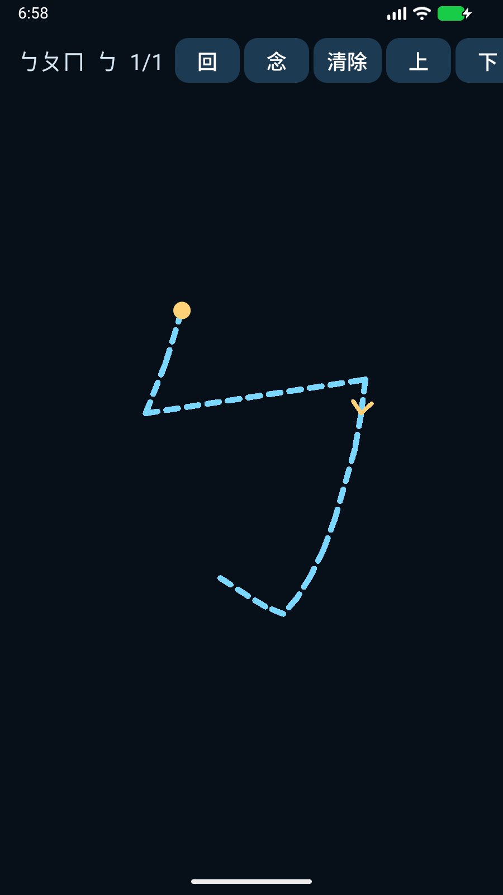
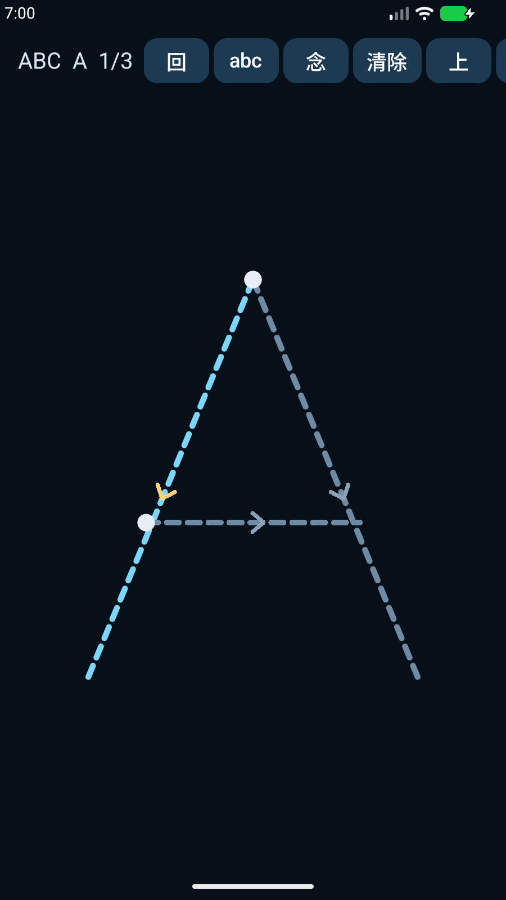

# 筆順學習 StrokeLearn

離線 Android 練習 App。用手指沿著虛線和箭頭寫完每一筆，字形盡量鋪滿螢幕。不需要網路。發音使用手機內建語音。

Offline Android practice app. Trace each stroke along the dashed guide and arrow. The glyph fills the screen. No network permission. Speech uses the phone's built-in text-to-speech voice.

## 安裝 Install

Android 8 以上。到 [Releases](https://github.com/chihochangai-hash/StrokeLearn/releases) 下載 `StrokeLearn-1.1.apk`，允許安裝不明來源的應用程式。

Android 8 or newer. Download `StrokeLearn-1.1.apk` from [Releases](https://github.com/chihochangai-hash/StrokeLearn/releases) and allow installs from this source.

## 可以練什麼 What you can practice

- **123**：從 1 寫到 100。10 以上由左到右逐個位數書寫，並念出「十五」「一百」。
- **ㄅㄆㄇ**：37 個注音符號，直接念符號本身。
- **ABC / abc**：大寫與小寫英文字母，使用英文語音。

- **123**: numbers 1 through 100. From 10 upward, write each digit from left to right. The app speaks the number in Chinese.
- **ㄅㄆㄇ**: all 37 Zhuyin symbols. The voice reads the symbol itself.
- **ABC / abc**: uppercase and lowercase English letters, spoken in English.

## 操作 How to use

- 單指沿著起點（黃點）和箭頭書寫。寫對會留下筆跡並進入下一筆。寫錯會變成紅色。
- **清除**會擦掉這一題已寫的筆畫，從第一筆重來。
- 兩指捏合或張開可縮放字形。比例會記在手機裡。
- **念**再讀一次。**上** / **下**換題。**回**回到選單。

- Draw with one finger from the yellow start dot, following the arrow. A correct stroke stays on screen and advances. A wrong stroke turns red.
- **清除** erases the current item and starts again at the first stroke.
- Pinch with two fingers to resize the glyph. The size is remembered.
- **念** speaks again. **上** / **下** move between items. **回** returns to the menu.

請在系統設定安裝繁體中文與英文語音，否則可能沒有聲音。

Install Traditional Chinese and English voices in the system settings if speech is silent.

## 畫面 Screenshots

選單 Menu

數字 1 / 100

寫完一筆 After a stroke

注音 ㄅ

英文字母 A

模擬器若沒有注音字型，選單上的注音可能顯示成替代字形。筆順路徑本身不依賴該字型。

If the device has no Zhuyin font, the menu label may show fallback glyphs. The stroke path does not depend on that font.
